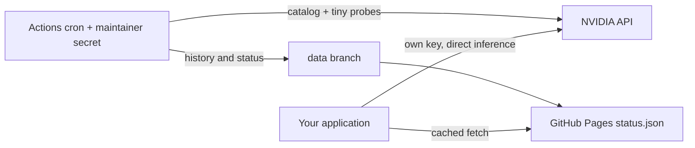

# nim-model-status

A GitHub Actions health monitor for NVIDIA's hosted API catalog. It discovers models, makes tiny health requests using **one maintainer-owned key**, and publishes ranked model names as static JSON on GitHub Pages. Applications fetch those names and call NVIDIA directly using their own credentials.

This service is **not a proxy**. It has no server, receives no application inference traffic or user keys, and implements no key pooling, account rotation or rate-limit evasion. GitHub's public repository, Actions and Pages allowances provide the hosting; check their current limits before use at scale.



## Verified NVIDIA API facts

Checked 2026-11-12 against the [NVIDIA API reference](https://docs.api.nvidia.com/nim/reference/llm-apis), a [chat endpoint reference](https://docs.api.nvidia.com/nim/reference/openai-gpt-oss-120b-infer), and the [live model catalog](https://integrate.api.nvidia.com/v1/models):

- Base URL: `https://integrate.api.nvidia.com/v1`.
- Bearer authentication: `Authorization: Bearer <personal nvapi-… key>`. Keep the actual key only in a repository secret or your local environment.
- `GET /v1/models` returns an OpenAI-style `{"object":"list","data":[{"id":"…", ...}]}` envelope. Listing does not establish that a model is hosted for your account.
- `POST /v1/chat/completions` accepts OpenAI-compatible messages. NVIDIA documents `stream: true` as SSE `data:` deltas and exposes `tools` and `tool_choice` for supported models. Support is model-dependent; tools and JSON are verified here.

No authenticated live inference was performed to develop this project. A roughly 40 requests/minute/model trial limit is **an unverified report, not an entitlement**. Read the current [NVIDIA API terms](https://developer.nvidia.com/legal/terms-of-use) and your account's trial conditions. Use one personal key for tiny probes only; reread the terms before promoting this monitor widely.

## Setup

Requires Python 3.12 and Git. The commands below use Bash (Git Bash works on Windows).

1. Create a **public GitHub repository**, copy these files into its default `main` branch, and push. Do not commit credentials.
2. In Settings → Secrets and variables → Actions, create `NVIDIA_API_KEY` containing your personal NVIDIA API key. Enable Actions and allow workflow write access if organization policy requires it.
3. Edit **only configuration**, not Python: replace the clearly marked placeholder IDs in `models.yml` with models from the live catalog. Assign tiers/capabilities and ensure each alias has a possible candidate. The supplied placeholders intentionally do not produce live routing. The catalog is public at the URL above; inspect it in a browser. Commit the configuration to `main`.
4. Create and push the orphan `data` branch in a separate worktree:

   ```bash
   git worktree add --detach ../nim-status-data
   cd ../nim-status-data
   git switch --orphan data
   python -c 'import json; from datetime import datetime,timedelta,timezone; n=datetime.now(timezone.utc); print(json.dumps(dict(schema_version=1,generated_at=n.isoformat(),valid_until=(n+timedelta(minutes=40)).isoformat(),health="stale",run_id="bootstrap",aliases={},models={},unclassified=[],notes=["Awaiting first successful probe"])))' > status.json
   touch .nojekyll
   git add status.json .nojekyll
   git commit -m 'Initialize static status branch'
   git push -u origin data
   cd -
   ```

   `git switch --orphan` removes tracked files from this new worktree. Use a new disposable worktree as shown. `history.json` is created automatically on the first successful run; its absence logs a warning. The bootstrap document is schema-valid and deliberately empty; the monitor refuses to publish all-empty routing after probing.
5. Settings → Pages → Build and deployment → **Deploy from a branch** → `data` → `/ (root)`. Save. No additional Pages token is needed. GitHub may require the repository owner to verify an email address.
6. Actions → **Probe NVIDIA models** → Run workflow. Inspect the request-count summary. A successful run populates both state files and pushes `data`. The separate `pages.yml` workflow then requests a Pages build with only `pages: write` permission; it has no NVIDIA secret and executes no repository code. This is necessary because [GitHub documents that `GITHUB_TOKEN` pushes do not trigger Pages builds](https://docs.github.com/en/pages/getting-started-with-github-pages/configuring-a-publishing-source-for-your-github-pages-site). It uses the [Pages build API](https://docs.github.com/en/rest/pages/pages#request-a-github-pages-build), preserving your `data` branch root source. Run **Keep schedules enabled** manually once as well.
7. Wait for Pages deployment, then verify:

   ```bash
   curl -fsS https://USER.github.io/REPO/status.json
   curl -sI https://USER.github.io/REPO/status.json | grep -i access-control
   ```

   From the browser console on a **different HTTPS origin** (without a restrictive CSP), run:

   ```js
   fetch('https://USER.github.io/REPO/status.json')
     .then(r => { if (!r.ok) throw new Error(r.status); return r.json(); })
     .then(s => console.log(s.generated_at, s.aliases))
     .catch(console.error);
   ```

   Verify the CORS response and actual browser fetch; do not assume Pages is permissive. Use a same-origin cached copy if your hosting configuration fails this test. Raw fallback: `https://raw.githubusercontent.com/USER/REPO/data/status.json`. Prefer Pages: raw hosting is more constrained by rate limits.

**Check the Actions tab monthly.** Public-repository scheduled workflows can be disabled after 60 days without repository activity. Keepalive runs on the 1st and 15th and calls `gh workflow enable` for both schedules, but a disabled keepalive cannot wake itself. Re-enable both manually if necessary. Bot commits are not assumed to prevent disabling. See [GitHub schedule documentation](https://docs.github.com/en/actions/reference/workflows-and-actions/events-that-trigger-workflows#schedule).

## Local use and offline development

```bash
python -m venv .venv
source .venv/bin/activate
pip install -r requirements.txt
pip install --no-deps -e .
pytest -q
python -m nimstatus.main --offline tests/fixtures/healthy --dry-run
```

On PowerShell activate with `.venv\Scripts\Activate.ps1`. Online runs read `NVIDIA_API_KEY` from the environment. Never paste it into commands that enter shell history. `--dry-run` still makes probes unless paired with `--offline`; it writes no files. `--data-dir PATH` defaults to `data`, `--config PATH` defaults to `models.yml`. Nonzero exit means publication failed. Offline mode needs no secret and uses `responses.json`: a discovery HTTP envelope and per-model `liveness`, `tools`, `json` HTTP envelopes, optional SSE text or simulated `network`/`timeout` errors. Tests prohibit real httpx transport; JS tests replace fetch. `pytest` also invokes Node client tests if Node 18+ is installed (otherwise explicitly skips them); run `node --test tests/client.test.mjs` separately if desired.

Development validation: 32 pytest tests and the standalone Node test pass locally; the fixture dry run succeeds. The development machine provided Python 3.11.0, httpx 0.28.1, PyYAML 6.0.3, pytest 9.1.1 and Node 24.11.1. Downloading Python 3.12 was unsuccessful, so exact Python 3.12/pinned-dependency validation is not claimed locally. The probe workflow installs the pinned requirements and runs the offline suite on Python 3.12 **before** the sole secret-bearing step. Live account access, push permissions, Pages delivery and CORS require owner verification during setup.

## Configuration and operation

`models.yml` is the only model classification source. Add an ID from `unclassified`, set `tier: small | medium | large`, and declare `capabilities: [chat, code, tools, json]` as appropriate. `preference` is a manual boost between -1 and +1, default 0. Aliases specify `min_tier`, required capabilities and optional `prefer_speed`. Unknown tiers, impossible aliases and invalid settings fail validation. No IDs are embedded in implementation code.

Unknown catalog IDs never enter aliases automatically. `exclude_patterns` are case-insensitive **substrings**, applied to unclassified IDs; explicitly configured models remain under your control. Missing catalog entries become `listed: false` and unavailable, with at most daily probing. Discovery failures reuse the previous catalog and never turn a failed GET into mass removal; a first run without any previous catalog fails safely.

Defaults: 30-second **total** request deadline, 64 output tokens, temperature zero, 40 liveness candidates/run, at most 5 simultaneous requests, random 0–2-second gaps between launches. Selection prioritizes least-recently-probed IDs. There are at most `max_models_per_run + 10` POST requests including compatibility fallbacks and capabilities, plus one catalog GET. The count is logged even on probe failure. No timeout, 429, 5xx or network failure is retried. An explicit unsupported-stream error permits a non-streaming compatibility request, and an explicit unsupported-`response_format` error permits a prompt-only JSON request. Both consume the budget. Tools and JSON verification occur at most once per capability every six hours per model; liveness runs first, then oldest due verifications. The extra ten-request allowance may delay capability verification across runs.

Liveness strips think blocks. `pong` passes the canary; other nonempty visible text with finish reason `stop` or `length` passes liveness with `canary_ok: false`. Reasoning that consumes all 64 tokens can fail; increase `max_tokens` cautiously if needed. Streaming records first **content** delta latency, with total latency always recorded; JSON responses to streaming requests are accepted with null TTFT. Tools require a function call ID, correct name, JSON arguments and a nonempty string `city`. JSON capability requires a JSON object, without Markdown fences.

Scores use a 24h window, six-hour exponential half-life, success=1, throttled=0.4 and other failures=0. Latency uses successful-probe median TTFT when available, otherwise median total time: factor 1 at ≤3s, linearly declining to 0.2 at ≥20s. Score is `availability² × latency_factor × (1 + preference)`. Speed aliases multiply by latency factor again. Unprobed/zero-availability models are excluded. Code capability is a manual classification, not a benchmark.

Three consecutive timeout/server/network failures open the circuit. Backoff skips 1, 2, 4, 8… runs, capped near six hours at the configured interval. Two successful probes close it. A 404/410 immediately makes it unavailable with daily checks. Alias primary changes only on ineligibility, score below 0.5, or a challenger leading by ≥0.15 for three consecutive evaluated runs. Scores used by speed aliases include their extra latency weighting. Up to four eligible fallbacks follow the primary. A failed/unverified capability cannot receive a new capability-dependent assignment; last-known-good safety routing can still retain an old assignment marked stale.

## Published document and durable state

`status.json` schema version 1:

```json
{
  "schema_version": 1,
  "generated_at": "2026-11-12T14:05:00Z",
  "valid_until": "2026-11-12T14:45:00Z",
  "health": "ok",
  "run_id": "local",
  "aliases": {"fast": {"primary": "<configured-id>", "fallbacks": [], "stale": false}},
  "models": {
    "<configured-id>": {
      "status": "closed", "listed": true, "score": 0.87, "availability": 0.98,
      "p50_total_ms": 1400, "p50_ttft_ms": 420,
      "capability_verified": {"tools": true, "json": true},
      "last_probed": "2026-11-12T14:05:00Z"
    }
  },
  "unclassified": [],
  "notes": []
}
```

Times are UTC ISO 8601; latencies are milliseconds or null; `last_probed` may be null. Capability keys are absent until tested. Circuit states: `closed`, `open`, `unavailable`. Empty aliases carry `primary: null`, `fallbacks: []`, `stale: false`, and `reason`. A previous nonempty alias is retained with `stale: true` if it would become empty. `health` is `ok`, `degraded` for partial stale/empty aliases or discovery warnings, and `stale` if all aliases retain old routing. Clients should inspect per-alias stale flags too.

`valid_until` is generation time + four configured intervals. A status rewrite occurs for routing, circuit, listing, capability, classification or health/note changes, or after a six-hour heartbeat. Score-only drift and timestamps do not trigger publication. **This means a stable document intentionally expires between heartbeats**: clients continue using it with a stale warning. If you need consistently fresh documents, shorten the heartbeat policy or change the publication policy deliberately; the monitor preserves the requested six-hour gate.

`history.json` schema version 1 contains run count, last catalog, alias challenger streaks, circuits, capability results with timestamps, and 48h of raw probe records. On disk records use `{base, rows}`: each row is `[seconds_since_base, ok_0_or_1, http_status, error_index, ttft_ms, total_ms, canary_0_or_1]`. Error enum order is `ok, timeout, throttled, server_error, not_found, auth, client_error, network, malformed`. Timing is rounded to milliseconds. `history.load` exposes named records; older named-record input is also accepted. Older records become fixed-size lifetime counts and an EWMA. Typical 40-model history fits below 500 KB; more configured models or faster schedules increase size. JSON writes use temporary files and rename; both documents are validated/prepared before writing, but the pair is not a filesystem-wide atomic transaction. Corrupt or missing history warns and starts fresh.

**Persistence versus commit gating:** GitHub runners are ephemeral. Persisting every probe, rotation position, circuit counters and hysteresis streak requires committing history even when public status does not change. The workflow therefore commits changed history every successful run and gates **status rewrites** on meaningful changes/heartbeat. Literal suppression of every timestamp-only data commit would lose required state. Commits use only a nonempty staged diff; push races get at most three push attempts with rebase, and conflicts fail instead of overwriting another update. The probe concurrency group serializes normal runs.

An auth error aborts with `NVIDIA_API_KEY missing, invalid, or expired` and records nothing. A run with ≥80% network/timeout failures is treated as a global/probe-side outage, exits nonzero and leaves both files unchanged. The outage note appears in the Actions log, **not** in `status.json`, because changing that file would contradict rollback. Total alias emptiness also fails publication. Request/response bodies, credentials and third-party exception text are never logged or persisted. Enable GitHub failure notifications for this workflow; notification delivery depends on your account settings.

## Client helpers

Copy the helper into your app. Both return `[primary, ...fallbacks]`, deduplicated; cache per URL for ≥300 seconds, keep the last good copy on fetch errors, use caller-provided defaults when needed, and warn when retained/expired/default routing is used. Fetch timeout is three seconds. Failed refresh attempts are cached for the TTL as well. There is no background refresh. Keep the cache in a long-lived process/module; repeated process starts do not share it. JS shares concurrent in-flight fetches. Neither helper accepts an NVIDIA key.

Python (helper is stdlib-only; the SDK belongs to **your application**):

```python
import os
from openai import OpenAI, APIConnectionError, APITimeoutError, APIStatusError
from nimstatus_client import resolve, call_with_fallback

options = {
    "status_url": "https://USER.github.io/REPO/status.json",
    "defaults": {"fast": ["<your-tested-default-id>"]},
}
models = resolve("fast", options)
api = OpenAI(base_url="https://integrate.api.nvidia.com/v1",
             api_key=os.environ["NVIDIA_API_KEY"], max_retries=0)
def retryable(error):
    return isinstance(error, (APIConnectionError, APITimeoutError)) or (
        isinstance(error, APIStatusError) and (error.status_code == 429 or error.status_code >= 500))
answer = call_with_fallback(
    "fast",
    lambda model: api.chat.completions.create(model=model, messages=[{"role": "user", "content": "Hello"}]),
    options, retryable=retryable, max_attempts=3,
)
```

JavaScript (helper supports Node 18+ and browsers; use inference SDK credentials only in your own trusted backend):

```js
import OpenAI from 'openai';
import {resolve, call_with_fallback} from './nimstatus-client.mjs';
const options = {
  status_url: 'https://USER.github.io/REPO/status.json',
  defaults: {fast: ['<your-tested-default-id>']},
};
const models = await resolve('fast', options);
const api = new OpenAI({baseURL: 'https://integrate.api.nvidia.com/v1',
  apiKey: process.env.NVIDIA_API_KEY, maxRetries: 0});
const answer = await call_with_fallback('fast',
  model => api.chat.completions.create({model, messages: [{role: 'user', content: 'Hello'}]}),
  {...options, max_attempts: 3,
   retryable: e => e.status === 429 || e.status >= 500 ||
     e instanceof OpenAI.APIConnectionError || e instanceof OpenAI.APIConnectionTimeoutError});
```

Caller classification controls retries: auth and bad requests must return false and rethrow immediately; 429, 5xx and timeouts can try the next model. Helpers stop at `max_attempts` (default 5) and rethrow the final original exception. Applications still choose their own per-inference deadlines. Never put a personal API key in browser JavaScript.

## Limitations and troubleshooting

- GitHub cron runs can lag: expect actual cadence around 10–25 minutes, sometimes longer. The cron avoids the top of the hour. Pages/CDN may lag by several more minutes. Cache about five minutes and **never poll more often**. `valid_until` detects stale data; availability of this service must not be required to start your app.
- A single GitHub-hosted probe location is one vantage point. Your region, quota and key may behave differently. A healthy probe is not a quality guarantee, a code benchmark, or proof of reliable long completions. Trial access, model support and terms may change.
- Empty aliases on first run: replace placeholder IDs, check the current catalog, tiers and required capabilities. Tools/JSON aliases wait for successful verification. Some models need a larger token allowance for visible output.
- Auth failure: check the secret's spelling, expiration and account permissions. No automatic key rotation exists. Discovery may work even when inference permissions fail. Never post credentials or request dumps in issues.
- Outage: consult the constant-text guard message and request count; previous files should remain unchanged. A one-model run with a timeout triggers the conservative global guard. No history exists yet: fix discovery or eligible models and rerun manually.
- Pages 404 or stale: check the `data` branch, Pages branch/root setting, deployment status, CDN and `valid_until`. Initial `.nojekyll` permits static serving. Inspect **Refresh branch-source Pages**; run it manually if needed. It requires your account/organization to allow the Pages build API with the workflow token. This deployment path must be verified in your repository; it cannot be integration-tested offline.
- Disabled schedule: enable both workflows in Actions; keep the monthly reminder. `gh workflow enable` may be restricted by organization policy.
- History commit conflict: inspect the external change, resolve it on `data`, then rerun. Never force-push away probe state. If history is corrupt, the next successful run rebuilds state; hysteresis and aggregates restart.
- Large configuration: rotation increases time between probes. A 24h window without samples removes eligibility; last-known-good then takes over. The 8-minute job limit can be reached by unusually slow requests or very large budgets; keep defaults conservative.

## Assumptions

1. Hosted API catalog discovery is OpenAI-shaped; endpoint listing is not a guarantee of inference access. No live authenticated call was used during development.
2. `Authorization`/`Bearer` are defaults; `auth_header`, `auth_scheme` and HTTPS `base_url` can be configured. One secret is used throughout. Redirects and environment HTTP proxies are disabled to avoid credential forwarding.
3. Supplied model IDs are placeholders. Maintainers manually replace/tag them, judge tiers and code capability, and supply tested client defaults. No source code edit is required.
4. Tier ordering is small < medium < large; capability names are chat/code/tools/json; exclusions are substrings. A preference of -1 can reduce score to zero.
5. Unknown or never-tested tools/JSON capability is ineligible; both verifications have separate six-hour schedules. A verification failure remains excluded until it passes, with last-known-good stale routing as the explicit safety exception.
6. Liveness tolerates non-PONG visible completions with stop/length; this is availability, not instruction-following quality. Think blocks are removed, and TTFT measures first content delta rather than hidden reasoning.
7. Compatibility requests for explicitly unsupported streaming/JSON options are allowed exceptions to no retry; each counts toward the hard budget. Discovery is one additional GET outside the POST budget.
8. Availability weights use a six-hour half-life, medians use successful probes only, and no samples imply zero availability. Exponential circuit backoff is measured in runs; unavailable models use wall-clock days. The global guard is conservative even for small sample sizes.
9. Aliases exclude zero-availability candidates; speed weighting applies to challenger comparisons too. Challenger streaks count successful evaluated runs and survive history commits; failed whole runs neither advance nor reset them.
10. An outage log note satisfies diagnostics while preserving both previous files. A history file is committed each successful run to preserve ephemeral-runner state; meaningful-change gating applies to public status rewrites. Six-hour heartbeats intentionally allow stable status to expire between updates.
11. A previous nonempty alias is treated as last-known-good, even if already stale. Repeated degradation can retain it indefinitely; consumers must heed stale warnings and use application defaults/fallbacks.
12. Default 40-model/10-minute operation is the history-size target. Compact raw rows round latency to milliseconds. Both file writes are individually atomic, not jointly transactional against disk/process failure.
13. The data branch and Pages are created by the owner; `main` is the default branch; organization policy allows the documented token permissions and Pages build API. Full action major tags are used. GitHub hosted Ubuntu has `gh` installed. A third workflow (`pages.yml`) is necessary to request branch-source builds after token pushes without broadening the probe workflow's permissions; it runs on probe completion or manual dispatch only.
14. Keepalive and bot commits cannot guarantee perpetual scheduling. Monthly human checks, account notification preferences, client cache and expiry handling are required safeguards.
15. Clients warn instead of returning metadata, require TTL ≥300 seconds, throttle failed refreshes too, and retain expired data indefinitely on fetch error. Their caches are process-local; users classify inference exceptions and control inference deadlines. No inference key passes through a helper.

MIT licensed. Unaffiliated with NVIDIA.
